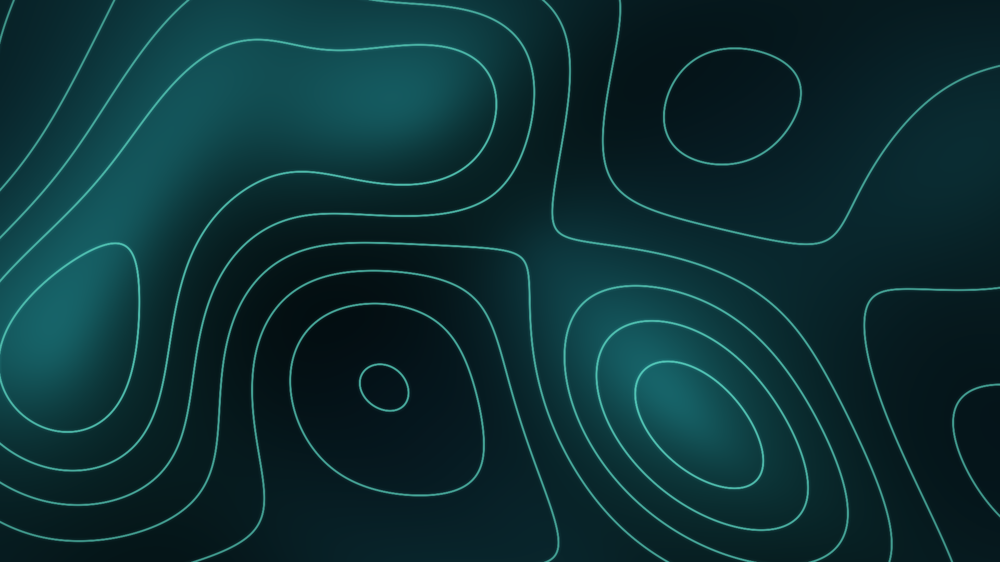

<p align="center">
  <a href="https://github.com/jeremykenedy/contour-flow#gh-light-mode-only"><picture><source media="(max-width: 600px) and (prefers-reduced-motion: reduce)" srcset="art/banner-mobile-still-light.73a6d15f0630.svg"><source media="(prefers-reduced-motion: reduce)" srcset="art/banner-still-light.65bfbcddc376.svg"><source media="(max-width: 600px)" srcset="art/banner-mobile-light.66f89e0b9682.svg"></picture></a>
  <a href="https://github.com/jeremykenedy/contour-flow#gh-dark-mode-only"><picture><source media="(max-width: 600px) and (prefers-reduced-motion: reduce)" srcset="art/banner-mobile-still-dark.ce60a2688cd0.svg"><source media="(prefers-reduced-motion: reduce)" srcset="art/banner-still-dark.804b53dc973d.svg"><source media="(max-width: 600px)" srcset="art/banner-mobile-dark.2c2f5ae8c069.svg"></picture></a>
</p>

<p align="center">Animated topographic contour lines for Fire TV, Android TV, and Google TV.</p>

<p align="center">
  <a href="https://github.com/jeremykenedy/contour-flow/releases"></a>
  <a href="https://github.com/jeremykenedy/contour-flow/releases"></a>
  <a href="https://github.com/jeremykenedy/contour-flow/actions/workflows/ci.yml"></a>
  <a href="LICENSE"></a>
</p>

<p align="center">
  <a href="https://github.com/jeremykenedy"></a>
  <a href="https://github.com/jeremykenedy/contour-flow/stargazers"></a>
  <a href="https://github.com/sponsors/jeremykenedy"></a>
</p>

## Table of Contents

- [Overview](#overview)
- [Screenshots](#screenshots)
- [Features and settings](#features-and-settings)
- [Requirements](#requirements)
- [Install and activate](#install-and-activate)
- [Fire TV Toolkit](#fire-tv-toolkit)
- [Privacy](#privacy)
- [Device support](#device-support)
- [Build and tests](#build-and-tests)
- [Documentation](#documentation)
- [License](#license)

## Overview

Contour Flow is an original Android DreamService that animates layered topographic lines over gently moving terrain fields. Its softly shifting relief creates a living map-like scene without labels, borders, or symbols.

Show some love by starring this repository on GitHub.

## Screenshots

The release renderer is shown below in an unmodified code 5 native Fire TV capture at 1920 x 1080. Code 6 preserves that scene and adds release packaging. See [the gallery and provenance](docs/ARTWORK.md) for settings, version and device details.

<p align="center"><a href="art/screenshots/contour-default-api30.png"></a></p>

## Features and settings

| Feature | What it does | Guide |
| --- | --- | --- |
| Animated terrain | Three continuously moving relief fields with smooth contour lines | [Architecture](docs/ARCHITECTURE.md) |
| Useful controls | Palette, density, speed, weight, lighting and brightness, with Random choices | [Settings](docs/CONFIGURATION.md) |
| TV operation | D-pad settings, full-screen preview and proper Dream lifecycle | [Installation](docs/INSTALLATION.md) |
| App-owned schema | Seven validated persistent controls for supported hosts | [Provider](docs/SETTINGS_PROVIDER.md) |
| Offline scene | No network permission, ads, analytics or tracking | [Privacy](docs/PRIVACY.md) |

## Requirements

- Android 6.0 (API 23) or newer.
- A TV device that supports Android DreamService screensavers.
- Python 3.10 or later and an authorized ADB connection for the optional computer installer. Build tools are listed in the [building guide](docs/BUILDING.md).

## Install and activate

Download `contour-flow.apk` and `contour-flow.apk.sha256` from the [latest release](https://github.com/jeremykenedy/contour-flow/releases/latest). Connect ADB to the TV, then run the installer:

```bash
adb connect TV_IP:5555
python3 install.py --device TV_IP:5555 --apk ~/Downloads/contour-flow.apk
```

The installer checks the APK checksum, records the previous screensaver selection and enabled state, shows the planned changes, and asks before applying them. To restore the previous selection:

```bash
python3 install.py --device TV_IP:5555 --restore
```

To restore and uninstall Contour Flow:

```bash
python3 install.py --device TV_IP:5555 --uninstall
```

You can also install the APK with the TV's package installer, preview it from the app list, and select Contour Flow in the device's screensaver settings. Menu names vary by device. The standalone installer does not change sleep timers or claim to prevent vendor software from changing system settings.

## Fire TV Toolkit

Install the catalogued app with [Fire TV Toolkit](https://github.com/jeremykenedy/fire-tv-toolkit):

```bash
firetv-screensavers --install=contour-flow --yes
screensaver --set=contour-flow
```

See [integrations](docs/INTEGRATIONS.md) for setup, removal and Fire TV UI controls.

## Privacy

Contour Flow requests no Internet permission and makes no runtime network requests. It has no ads, analytics, telemetry, crash reporting, tracking, or remote update checks. All scene animation is rendered locally. See [Privacy](docs/PRIVACY.md).

## Device support

| Target | Verified behavior | Limit |
|---|---|---|
| Android TV emulator, API 34, 1920 x 1080 | Native preview, remote settings, visible motion and lifecycle | Emulator results do not establish hardware pacing |
| Fire TV, API 30, 1920 x 1080 | Candidate 5 native surface and three quiet presentation windows around 32.8 FPS | Physical Contour normal-idle startup and sustained thermals remain unverified |
| Other Android TV and Google TV hardware | Not yet verified | See [verification](docs/VERIFICATION.md) |
| Native 4K | Not verified | The app uses the surface Android provides |

## Build and tests

```bash
./test.sh
./build.sh --unsigned
./build.sh
```

The signed build creates a unique local signing key under `~/.android/`. Keep its key and password backed up securely. They are ignored by Git and required to sign compatible updates.

## Documentation

- [Architecture](docs/ARCHITECTURE.md)
- [Artwork and screenshot provenance](docs/ARTWORK.md)
- [Building](docs/BUILDING.md)
- [Configuration](docs/CONFIGURATION.md)
- [Installation](docs/INSTALLATION.md)
- [Integrations](docs/INTEGRATIONS.md)
- [Animation development and measured limits](docs/ANIMATION_REWORK.md)
- [Privacy](docs/PRIVACY.md)
- [Release process](docs/RELEASING.md)
- [1.1.0 release notes](docs/RELEASE_NOTES_1.1.0.md)
- [Settings provider](docs/SETTINGS_PROVIDER.md)
- [Troubleshooting](docs/TROUBLESHOOTING.md)
- [Verification and device matrix](docs/VERIFICATION.md)

## License

Contour Flow is licensed under the [Apache License, Version 2.0](LICENSE). See [NOTICE](NOTICE) for project notices.
