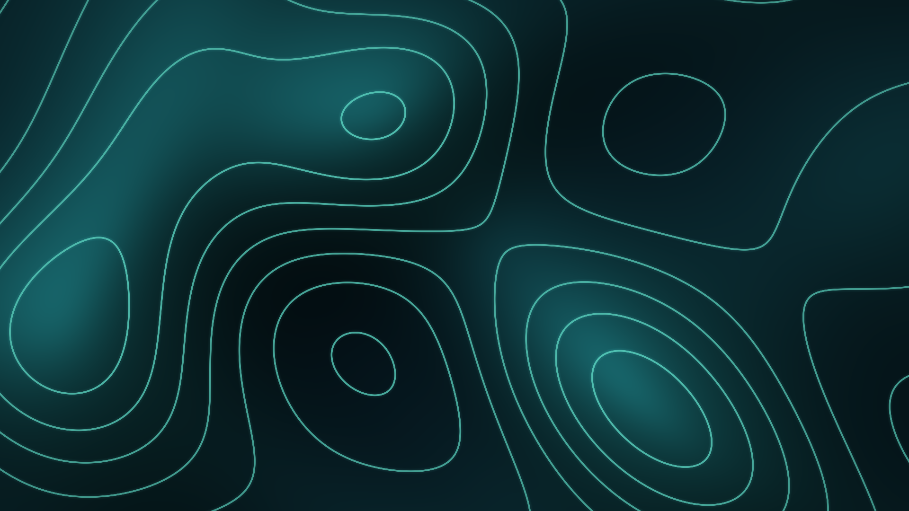
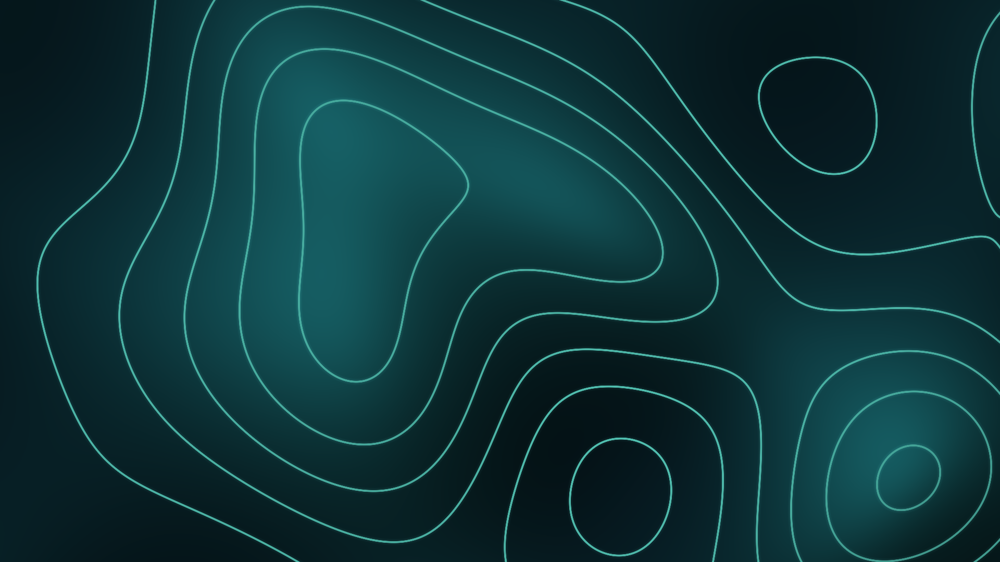
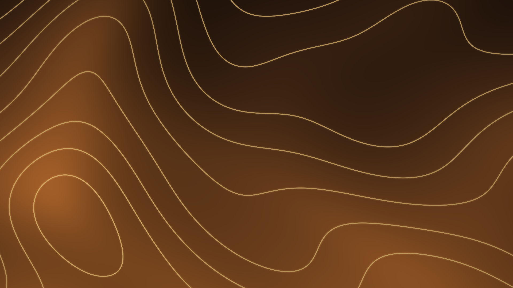
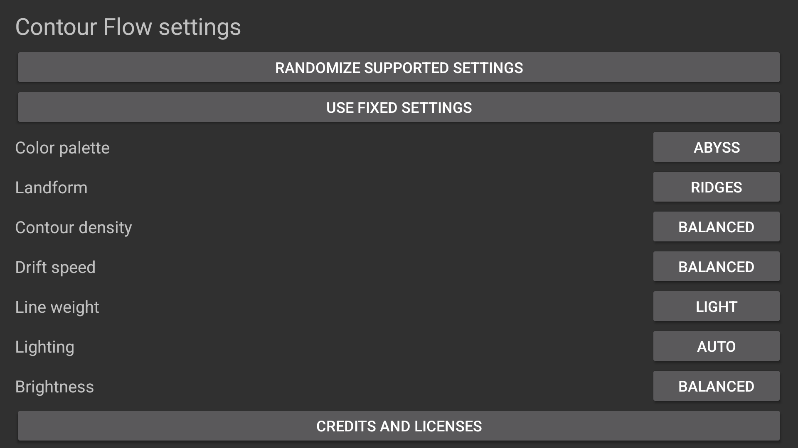
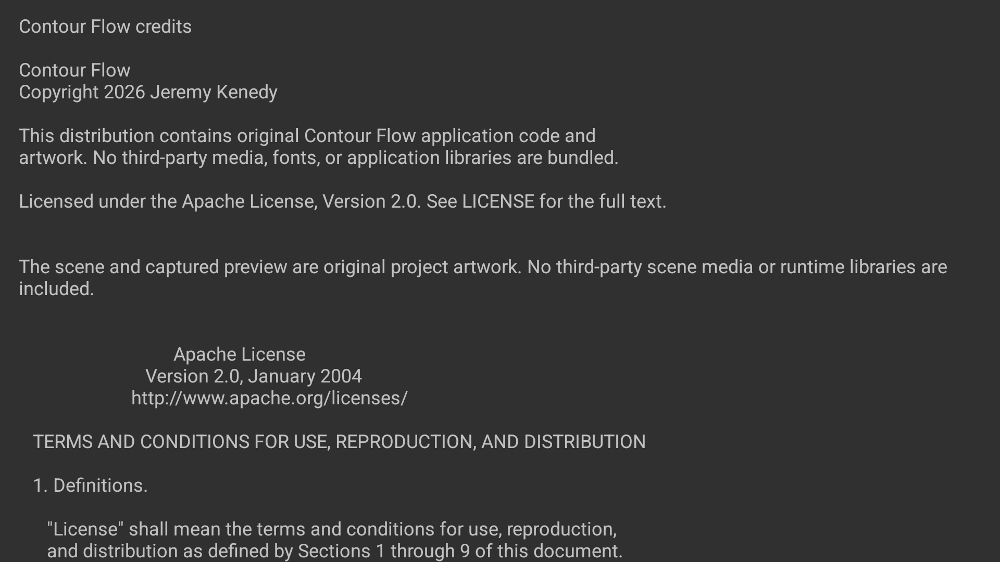
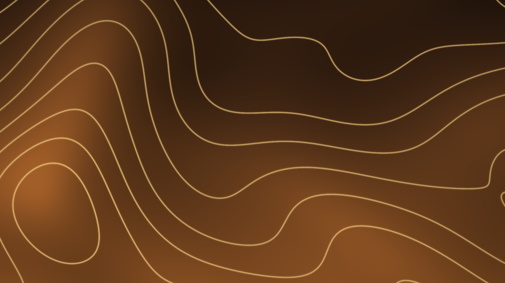

# Artwork and screenshot provenance

The contour field, renderer, icon, banners and captured scene are original project artwork. No photos, video, external fonts or third-party visual assets are bundled. Complete project notices and Apache license text are available from Settings > Credits and licenses.

## Current code 6 native gallery

All current images below are unchanged 1920 x 1080 native captures from the signed 1.1.0/code 6 package on an API 34 Google TV emulator, current user 0. The default scene is an actual normal-idle Dream, not a manual Preview. Coast is the app's full-screen Preview. Exact settings, source filenames, byte sizes and SHA-256 hashes are in [provenance](../art/screenshots/provenance.json).

<table>
<tr><td></td><td></td><td></td></tr>
<tr><td></td><td></td><td></td></tr>
</table>

Default settings are Abyss, Ridges, density 3, speed 3, weight 2, Auto lighting and brightness 3. Coast changes only palette to Sandstone and relief to Coast. The Credits screenshot shows part of the native reader; the full reader body was checked against the bundled notices and license.

## Earlier physical code 5 evidence

<table><tr><td></td><td></td><td></td></tr></table>

These unchanged physical 1920 x 1080 images document code 5. They are not code 6 hardware captures. The release preserves the tested core renderer; see [verification](VERIFICATION.md) for the separate pacing measurements and limits.

`art/screensaver-preview.jpg` is a 384 x 216 Lanczos resize of the code 5 default physical capture, encoded at JPEG quality 95. The identical image is bundled as `res/drawable/preview.jpg`; no scene content is added or removed. Earlier Canvas screenshots under `docs/screenshots/` are historical 1.0 references and are not current release images.

The animated README banner is a vector illustration, not a screenshot. Desktop/mobile and light/dark variants have corresponding still files for reduced motion. Its appearance does not establish native renderer behavior. Runtime scene captures establish visible output only; hardware pacing and sustained thermals require separate evidence.
