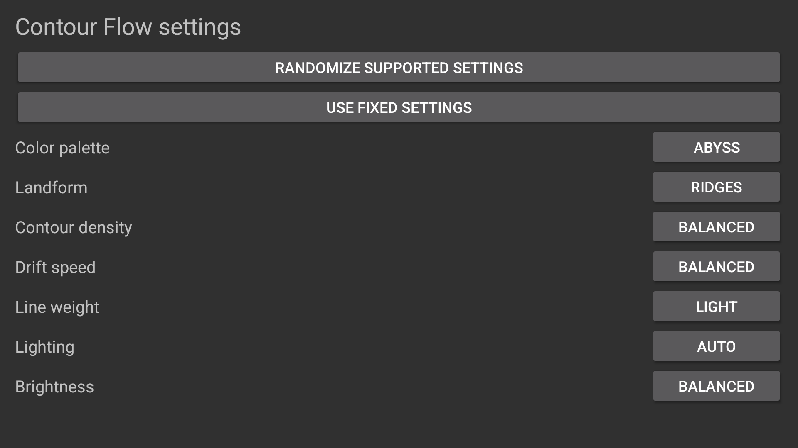

# Artwork and screenshot provenance

The contour field, renderer, icon, banners and captured scene are original project artwork. No photos, video, external fonts or third-party visual assets are bundled. Complete project notices and Apache license text are also available from Settings > Credits and licenses.

## Native scene gallery

<table><tr><td></td><td></td><td></td></tr></table>

All three images are unmodified native 1920 x 1080 screenshots. Default and Coast were captured on the original API 30 Fire TV running code 5; Settings was captured on an API 34 Android TV emulator. Their exact hashes, sizes and qualification are in [provenance](../art/screenshots/provenance.json). They show the core renderer preserved by code 6, not a new code 6 hardware performance run. Final code 6 Settings and Credits verification is recorded separately before publication.

`art/screensaver-preview.jpg` is a 384 x 216 Lanczos resize of the default physical capture, encoded at JPEG quality 95. The identical image is bundled as `res/drawable/preview.jpg`; no scene content is added or removed. Earlier Canvas screenshots under `docs/screenshots/` are historical 1.0 references and are not used as current release images.

The animated README banner is a vector illustration, not a screenshot. Desktop/mobile and light/dark variants have corresponding still files for reduced motion. Its appearance does not establish native renderer behavior. Runtime scene captures establish visible output only; frame pacing, normal-idle binding and sustained thermals require separate evidence.
